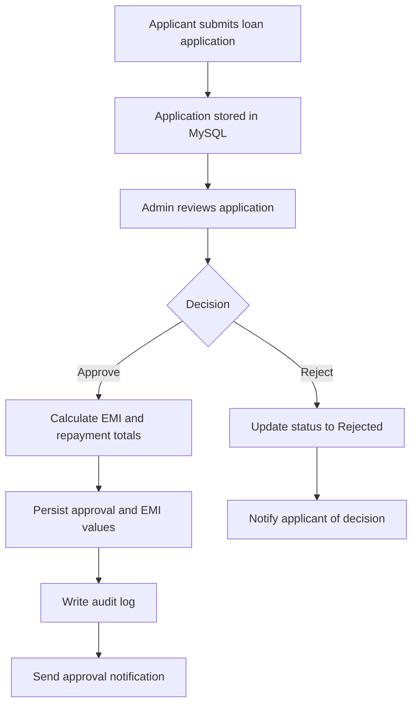

<div align="center">

# 🏦 Loan Application System
### Complete Enterprise Suite · Stages 1–5

**Core Java · JDBC · MySQL · Maven**

A modular console-based loan management application covering secure user access, administration, loan processing, credit scoring, and automated EMI calculations.

<br/>


[Features](#-feature-highlights) · [Architecture](#-project-architecture) · [Setup](#-getting-started) · [Run](#-run-the-application) · [Tests](#-testing) · [Security](#-security-notes)

</div>

---

## 📌 Table of Contents

<details>
<summary><strong>Click to expand</strong></summary>

- [Project Overview](#-project-overview)
- [Feature Highlights](#-feature-highlights)
- [Five Project Stages](#-five-project-stages)
- [Stage 4: PAN & CIBIL Engine](#-stage-4-pan--cibil-engine)
- [Stage 5: Loan Approval & EMI](#-stage-5-loan-approval--emi)
- [Project Architecture](#-project-architecture)
- [Technology Stack](#-technology-stack)
- [Getting Started](#-getting-started)
- [Run the Application](#-run-the-application)
- [Testing](#-testing)
- [Database Setup](#-database-setup)
- [Security Notes](#-security-notes)
- [Project Documentation](#-project-documentation)
- [Troubleshooting](#-troubleshooting)

</details>

## 🌟 Project Overview

The **Loan Application System** is an enterprise-oriented Java console application built with a layered architecture. It brings together five development stages in one organized project, with shared infrastructure for persistence, validation, services, and console interaction.

### What can it do?

- 👤 Register users, authenticate accounts, lock accounts after failed attempts, and reset passwords.
- 🛡️ Provide administrators with role-based access control (RBAC), user search and management, status changes, and audit logs.
- 📝 Accept loan applications and support application tracking, review, approval, and rejection.
- 🪪 Validate PAN formats and calculate illustrative CIBIL scores and loan-specific interest rates.
- 🔐 Generate usernames and temporary credentials, with credential-email functionality.
- 🧮 Calculate EMI, total interest, and total payable amount when a loan is approved.
- 📩 Send application-decision and approval notifications.
- 🗃️ Persist application and decision data using JDBC and MySQL.

> [!IMPORTANT]
> Credit scores and interest rates generated by this project should be treated as **demonstration logic**, unless connected to a verified credit bureau and an approved lending policy. A PAN format check does not establish that a PAN is genuine.

## ✨ Feature Highlights

<table>
<tr>
<td width="50%">

### 🔐 Account Management
- User registration and login
- Failed-login account lockout
- Password reset flow
- Input validation

</td>
<td width="50%">

### 🧑‍💼 Administration
- Role-based access control
- Search and edit users
- Activate / deactivate accounts
- Delete users and record audit activity

</td>
</tr>
<tr>
<td>

### 🏦 Loan Processing
- Loan application submission
- Loan-type interest assignment
- Applicant status tracking
- Admin review, approval, and rejection

</td>
<td>

### 📊 Credit & Repayment
- PAN format validation
- CIBIL score generation
- Loan interest range calculator
- EMI and repayment breakdown

</td>
</tr>
</table>

## 🧭 Five Project Stages

<details>
<summary><strong>Stage 1 — User Management</strong></summary>

- User registration and authentication
- Account lockout after repeated failed logins
- Password reset functionality
- Shared validation and user persistence

</details>

<details>
<summary><strong>Stage 2 — Admin Management</strong></summary>

- Role-based access control (RBAC)
- User search and editing
- Account activation and deactivation
- User deletion and notifications
- Administrative audit logging

</details>

<details>
<summary><strong>Stage 3 — Loan Application Management</strong></summary>

- Submit loan applications
- Assign interest rates based on loan type
- Track application status
- Admin review, approval, and rejection
- Notify applicants about decisions

</details>

<details>
<summary><strong>Stage 4 — PAN & CIBIL Engine</strong></summary>

- Validate PAN format and applicant details
- Generate a demonstration CIBIL score
- Calculate an interest rate within the configured loan-type range
- Generate username and password credentials
- Email credentials and persist score information

</details>

<details>
<summary><strong>Stage 5 — Loan Approval & EMI</strong></summary>

- Review and approve applications from the admin menu
- Calculate EMI, total interest, and total payable
- Persist approval and repayment values in MySQL
- Record administrative audit events
- Send an approval email containing seven repayment details

</details>

## 🪪 Stage 4: PAN & CIBIL Engine

### Interest-rate ranges

| Loan type | Configured range |
|---|---:|
| Home Loan | 6.5%–8.5% |
| Personal Loan | 9.0%–12.0% |
| Education Loan | 4.0%–6.0% |
| Vehicle Loan | 7.0%–9.0% |

The calculator validates the PAN structure (`5 letters + 4 digits + 1 letter`), accepts a loan type, generates a demonstration score from 600–900, and selects a rate within the configured range.

**Illustrative output**

```text
For PAN ABCDE1234F, with a CIBIL score of 720,
the interest rate for Home Loan is 7.5%.
```

### Generated account credentials

The documented username format is:

`First 3 letters of first name + first 3 letters of last name + last 4 mobile digits`

Example: `Shivani Chaudhari` + `9876543210` → `ShiCha3210`

A generated password is intended to be 8–10 characters and contain letters, numbers, and symbols. The system then emails the credentials, displays the generated credit score, and invites the user to apply for a loan.

> [!NOTE]
> Use a secure password-hashing mechanism for stored passwords. For real deployments, avoid emailing permanent passwords; prefer a short-lived, single-use activation or password-reset link.

## 🧮 Stage 5: Loan Approval & EMI

### EMI formula

For a fixed-rate loan with monthly repayments:

\[
EMI = \frac{P \times r \times (1+r)^n}{(1+r)^n-1}
\]

Where:

- **P** = principal loan amount
- **r** = monthly interest rate, calculated as `(annual rate / 12) / 100`
- **n** = loan tenure in months

Then:

- **Total payable** = EMI × number of months
- **Total interest** = total payable − principal

If the monthly interest rate is zero, EMI is calculated as principal divided by the number of months.

### Approval workflow



### Seven details in the approval email

1. Sanctioned loan amount
2. Loan type
3. Loan tenure in months
4. Applied annual interest rate
5. Monthly EMI
6. Total interest amount
7. Total payable amount

The intended approval flow updates the loan status, saves repayment calculations, records an administrative audit event, and sends a notification to the applicant.

## 🏗️ Project Architecture

The repository separates stage-specific requirements and notes from the shared application implementation.

```text
mainfile/
├── README.md
├── pom.xml
├── run-linux.sh
├── run-windows.bat
├── prompts/
│   └── ANTIGRAVITY_PROMPT.txt
├── rules/
│   └── PROJECT_RULES.txt
├── stages/
│   ├── stage1/
│   ├── stage2/
│   ├── stage3/
│   ├── stage4/
│   └── stage5/
└── shared/
    ├── src/main/
    │   ├── java/com/sit/loanapp/
    │   │   ├── config/
    │   │   ├── dao/
    │   │   ├── model/
    │   │   ├── service/
    │   │   ├── ui/
    │   │   ├── util/
    │   │   └── Main.java
    │   └── resources/
    │       ├── db.properties
    │       └── db.properties.example
    ├── tests/java/com/sit/loanapp/
    ├── sql/
    └── docs/
```

### Main packages

| Package / folder | Responsibility |
|---|---|
| `config/` | Database configuration and connection provider |
| `dao/` | JDBC data access for users and loan applications |
| `model/` | User, audit log, and loan application entities |
| `service/` | User, admin, loan, CIBIL, and notification logic |
| `ui/` | Console menus and safe input handling |
| `util/` | Validation rules and reusable policies |
| `shared/sql/` | Database schema and seed scripts |
| `shared/tests/` | Unit and integration tests |
| `shared/docs/` | Setup, architecture, and design documentation |
| `stages/` | Stage-specific source documents, requirements, rules, and notes |

## 🧰 Technology Stack

| Technology | Purpose |
|---|---|
| Java 17 or 21 | Core application logic |
| Maven 3.8+ | Dependency and build management |
| JDBC | Java-to-database connectivity |
| MySQL 8.0+ / MariaDB 10.5+ | Persistent data storage |
| JUnit (as configured in `pom.xml`) | Automated testing |
| SMTP/email integration (as configured) | Notifications and credential delivery |
| Bash / Windows Batch | Platform launch scripts |

## 🚀 Getting Started

### 1. Install prerequisites

Confirm these are installed and available in your terminal:

```bash
java -version
mvn -version
mysql --version
```

Required:
- JDK 17 or 21
- Apache Maven 3.8 or later
- MySQL Server 8.0+ or MariaDB 10.5+

If `mvn` is not recognized on Windows, install Maven and add its `bin` directory to your `PATH`, then open a **new** terminal and rerun `mvn -version`.

### 2. Configure the database

1. Start the MySQL server.
2. Review `shared/sql/schema.sql`.
3. Create the schema and tables:

   ```bash
   mysql -u root -p < shared/sql/schema.sql
   ```

4. Configure the connection using `shared/src/main/resources/db.properties` or the project's documented configuration approach. Use `db.properties.example` as a template.
5. Apply only the seed scripts that exist in the repository and match the schema you initialized.

> [!WARNING]
> The directory listing in this project description names seed files through `seed_stage4.sql`, while the original quick-start mentions `seed_stage5.sql`. Verify the actual filename before running it. Do not assume `seed_stage5.sql` exists.

### 3. Configure email

If email notifications are enabled, provide SMTP settings using the project's supported configuration method. Keep credentials outside source control, and use an app password or secret manager where appropriate.

## ▶️ Run the Application

Run commands from the project root (the directory containing `pom.xml`).

### Windows

```bat
run-windows.bat
```

Or run through Maven:

```bash
mvn clean compile exec:java
```

### Linux / KDE Plasma

```bash
chmod +x run-linux.sh
./run-linux.sh
```

> If a launcher fails, check its Java/Maven commands and ensure the database configuration is correct. The Maven command assumes the `exec-maven-plugin` and its main-class configuration are present in `pom.xml`.

## 🧪 Testing

Run the configured test suite:

```bash
mvn test
```

Tests listed in the project structure include:

- `ValidationUtilTest`
- `UserDaoTest`
- `UserServiceTest`
- `AdminServiceTest`
- `LoanServiceTest`
- `CibilServiceTest`

**Database note:** verify the test configuration before assuming tests use an in-memory database. The listed production database is MySQL; the test database mode depends on the actual test and Maven configuration.

## 🗄️ Database Setup

Expected SQL scripts listed in the project structure:

| File | Purpose |
|---|---|
| `schema.sql` | Database and table definitions |
| `seed_stage1.sql` | Sample Stage 1 users |
| `seed_stage2.sql` | Admin and user seed data |
| `seed_stage3.sql` | Sample loan applications |
| `seed_stage4.sql` | Sample PAN and CIBIL data |

Seed data is intended for development/testing. Review default credentials and permissions before use, and never deploy sample accounts to a live environment.

## 🔒 Security Notes

Before using this project with real users or financial information:

- Store passwords as salted hashes using a modern password-hashing algorithm; never store plaintext passwords.
- Keep database and SMTP credentials out of Git.
- Use prepared statements for all user-supplied SQL values.
- Enforce authorization checks in service-layer operations, not only in console menus.
- Validate inputs on the server side and avoid logging passwords, PANs, or other sensitive personal data.
- Use transactions for approval updates, repayment calculations, and audit records where consistency is required.
- Treat generated credit scores as demo values unless backed by an authorized, verified source.
- Follow applicable privacy, financial-services, and data-protection requirements before any real-world deployment.

## 📚 Project Documentation

Explore the supporting guides:

- `README.md` — project overview and execution guide
- `shared/docs/ARCHITECTURE.md` — architectural design
- `shared/docs/DATABASE_SETUP.md` — database configuration
- `shared/docs/DECISIONS_AND_ASSUMPTIONS.md` — design decisions and assumptions
- `shared/docs/LINUX_SETUP.md` — Linux setup
- `shared/docs/WINDOWS_SETUP.md` — Windows setup
- `rules/PROJECT_RULES.txt` — overarching project standards
- `prompts/ANTIGRAVITY_PROMPT.txt` — preserved original project prompt
- `stages/stage1/` through `stages/stage5/` — stage-specific requirements, rules, and notes

## 🛠️ Troubleshooting

<details>
<summary><strong><code>mvn</code> is not recognized</strong></summary>

Install Maven, add the Maven `bin` directory to the system `PATH`, then reopen the terminal. Verify with `mvn -version`.

</details>

<details>
<summary><strong>Database connection fails</strong></summary>

- Confirm the MySQL service is running.
- Check the host, port, database name, username, and password in the configuration.
- Confirm the schema was initialized.
- Check that the JDBC driver dependency is declared in `pom.xml`.

</details>

<details>
<summary><strong>Email notification fails</strong></summary>

- Verify SMTP host and port.
- Confirm authentication and TLS settings.
- Check provider-specific app-password requirements.
- Inspect logs without exposing secrets or personal information.

</details>

<details>
<summary><strong>Tests fail</strong></summary>

- Run `mvn test` from the project root.
- Review the first underlying exception in the test output.
- Check test database configuration and expected seed data.
- Confirm that the schema and test assumptions are consistent.

</details>

---

<div align="center">

### 💡 Built to demonstrate an end-to-end loan processing workflow

**Registration → Credit Assessment → Application → Admin Decision → EMI & Notification**

<sub>Educational project. Credit scoring, lending decisions, and personal-data handling require appropriate verification and controls before real-world use.</sub>

</div>
